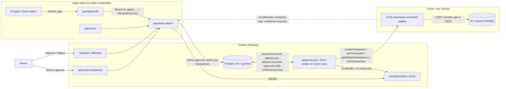

# Architecture

## Trust boundaries
- **Agent:** has only a Twokey agent key, stored as `HMAC-SHA-256(pepper, key)`. It can request and cancel. It can't approve, can't see wallet ids, and is rate-limited to 30 requests a minute.
- **Web:** has no Circle credentials. `instrumentation.ts` and `lib/server.ts` refuse to start if `CIRCLE_API_KEY` or `CIRCLE_ENTITY_SECRET` is set. Approvals require an owner session (argon2id password, server-side session, HttpOnly cookie) plus a CSRF double-submit header.
- **Executor:** the only process with the Circle client. It exposes only `/healthz`.
- **Database:** `audit_log` rejects UPDATE, DELETE and TRUNCATE via trigger. Optional least-privilege roles are in `packages/db/sql/roles.sql`.

## Classification runs three times
1. At request (`requestPayment`), under the per-org advisory lock, so concurrent requests can't both squeeze under the daily cap.
2. At decision (`decideApproval`): an invariant that now fails voids the approval.
3. In the executor (`prepareExecution`), under the same lock, on a balance read fresh from Circle. If the lane has risen, it asks for approval. If an invariant fails, it blocks. If the seal no longer matches, it voids.

## Exactly-once payment
- `attempts` has a partial unique index (one live attempt per intent) and a unique `circle_idempotency_key`.
- The key is committed **before** `createTransaction` (write-ahead). After a timeout or 5xx the attempt becomes `UNCONFIRMED`, and reconcile first looks for our `refId` at Circle, then replays the **same** key.
- A crash between the commit and the Circle call leaves `PENDING_SUBMIT`. The sweeper turns that into `UNCONFIRMED` after 15 s, and the same path recovers it.
- `FAILED`, `DENIED` and `CANCELLED` are terminal and never retried. A retry is a new request, classified again.

## Deviations from the PRD (and why)
- **Money uses bigint micro-units instead of decimal.js:** exact for a fixed 6-dp asset, with no rounding mode to misconfigure.
- **Styling uses the live site's CSS tokens instead of Tailwind + shadcn:** it matches twokey.online one-to-one.
- **Circle webhooks are verified in the executor, not the web route:** fetching Circle's public key (`getNotificationSignature`) needs the API key, which web must never hold.
- **Circle is behind a `CirclePort` interface in tests instead of msw:** the integration tests count calls on a fake that honors idempotency keys the way the API does.
